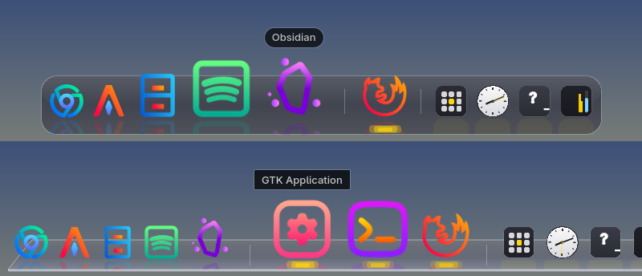
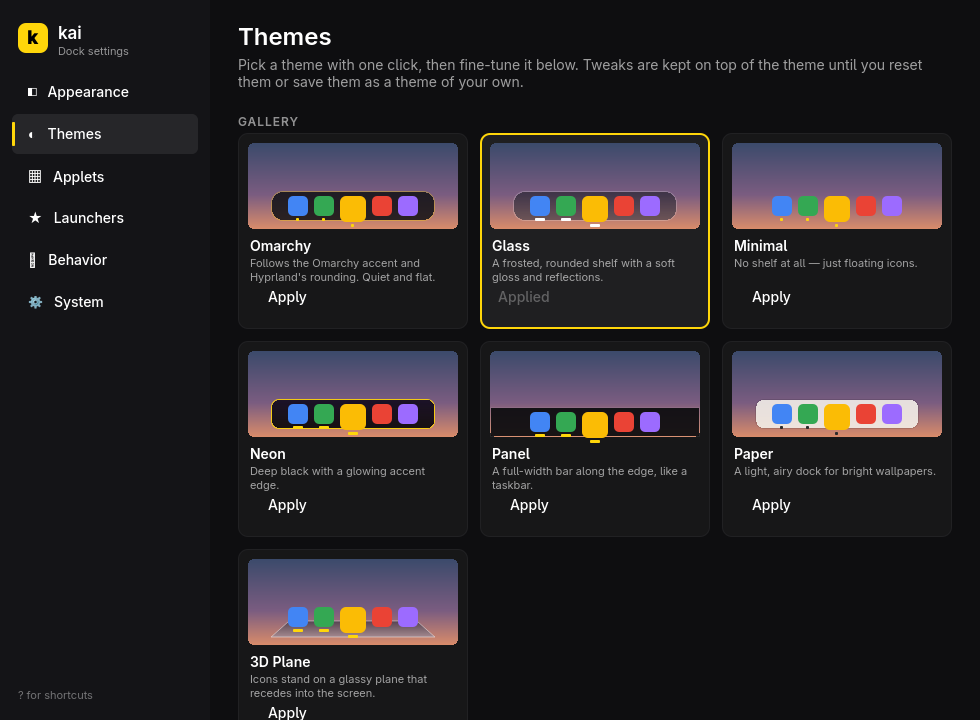

# kai

A classic, full-featured dock for Hyprland, in the spirit of Cairo-Dock:
floating shelves, a 3D plane, parabolic zoom and animated icons, applets that
can live in the dock or on the desktop as desklets, and themes you apply with
one click and fine-tune in a settings window.





## What it does

- **Looks**: floating, panel or 3D-plane views on any screen edge; parabolic
  magnification; gloss, reflections and icon shadows; running indicators as
  dots, bars or a glow. Follows the Omarchy accent and Hyprland's rounding
  unless a theme says otherwise.
- **Animations**: bounce, pulse, flip, wobble or blink, separately for clicks,
  app launches and windows asking for attention.
- **Apps**: pinned launchers plus running apps, matched to their `.desktop`
  files. Click to open, focus or minimize; middle-click for a new window;
  scroll to cycle windows; right-click for the window list, pinning and closing.
  Drag to reorder, drag off to unpin. Minimizing uses Omarchy's
  `special:minimized` workspace, the same as Omarchy's own dock.
- **Applets**: Applications, Clock, Weather (Open-Meteo, no key), System
  monitor, Battery, Trash. Each one can sit in the dock or be detached as a
  desklet on the desktop. Drag a desklet to move it; hover it to put it back.
- **Themes**: Omarchy, Glass, 3D Plane, Panel, Neon, Paper, Minimal. Install
  more from a URL or file with one click, tweak any setting on top, and save
  the result as your own theme. Themes are plain JSON in
  `~/.local/share/kai/themes`.
- **Rendering**: OpenGL by default. The software renderer is for flaky
  graphics drivers (Settings → System, or `kai --software`). Effects that need
  the GPU turn themselves off when Qt falls back to software.
- **Language**: follows Omarchy's language live. Ships with English and Norwegian.

## Shortcuts

| Where | Key / action | Does |
|---|---|---|
| Dock | Click | Open, focus, or minimize (cycles when several windows) |
| Dock | Middle-click | New window |
| Dock | Scroll | Cycle the app's windows |
| Dock | Right-click | Windows, pin/unpin, close; applet options |
| Dock | Drag | Reorder pinned apps; drag off the dock to unpin |
| Settings | Ctrl+1 … 6, Ctrl+Tab | Switch page |
| Settings | Esc, Q | Close settings |
| Settings | Ctrl+Q | Quit the dock |
| Settings | ? | Show all shortcuts |

## Commands

```sh
kai                       # start the dock, or open Settings if it's running
kai settings              # open Settings
kai apps                  # open or close the app launcher
kai quit                  # stop the dock
kai --software            # start with the CPU renderer this once
kai theme list [--json]
kai theme install FILE [--json]
kai theme apply ID [--json]
```

To start kai with the desktop, add this to `~/.config/hypr/autostart.lua`:

```lua
o.launch_on_start("kai")
```


### Replacing an icon in the dock

Drop `<icon-name>.svg` or `.png` into `~/.local/share/kai/icons/` to replace
that icon in kai only; the system icon theme and other launchers are left
alone. The icon name is the `Icon=` value from the app's `.desktop` file.

## Build

Needs `qt6-base qt6-declarative qt6-wayland qt6-svg layer-shell-qt`.

```sh
bin/build     # build/kai
bin/test      # Qt Test suite, offscreen
bin/install   # makepkg -fsi: installs kai, its icon and launcher entry
bin/deploy    # build, test, install to ~/.local/bin and restart the running dock
```

## Theme format

```json
{
  "name": "Sea Glass",
  "view": "floating",
  "background": "#0d3b4a", "background2": "#1f6f80", "backgroundOpacity": 0.7,
  "border": "accent", "borderOpacity": 0.4, "borderWidth": 1,
  "radius": 18, "padding": 9, "spacing": 7,
  "gloss": 0.15, "reflection": 0.3, "iconShadow": 0.3,
  "indicator": "glow", "indicatorColor": "accent"
}
```

`"accent"` means the Omarchy accent, and a `radius` of `-1` follows Hyprland.
Unknown keys are ignored, so a theme can only change how the dock looks.
